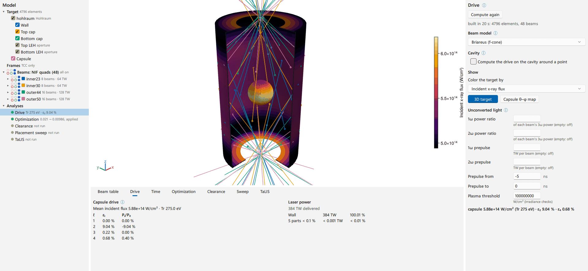

# BriareusGUI.jl

**BriareusGUI** provides a desktop window for [Briareus.jl](https://github.com/stillyslalom/Briareus.jl) laser-pointing
and view-factor radiation design: build a hohlraum or backlighter target, point the
beams, see the laser deposition and x-ray drive, optimize the pointing, and check beam
clearance from the hardware and the TaLIS target-configuration rules, all in one
window, with VisRad pointing, beam-summary and workspace files in and out.



The [Desktop application](https://stillyslalom.github.io/Briareus.jl/dev/gui/) page of
the documentation describes the window, a first session and every panel.

## Install the `briareus` command

1. Install Julia 1.12.7 or later through juliaup: on Windows `winget install --id
   9NJNWW8PVKMN -e`, on macOS or Linux `curl -fsSL https://install.julialang.org | sh`.
   Open a new terminal afterward.
2. Install the app and compile it, about ten minutes once:
   `julia -e "using Pkg; Pkg.Apps.add(\"BriareusGUI\")"`, or `pkg> app add BriareusGUI`
   at the Julia prompt.
3. Put Julia's app folder (`~/.julia/bin`) on the `PATH`; the install prints a warning
   when it is missing. Windows, in PowerShell:

   ```powershell
   $p = [Environment]::GetEnvironmentVariable("Path", "User")
   [Environment]::SetEnvironmentVariable("Path", "$p;$HOME\.julia\bin", "User")
   ```

   macOS (zsh): `echo 'export PATH="$HOME/.julia/bin:$PATH"' >> ~/.zprofile`; Linux
   (bash): the same line appended to `~/.bashrc`.
4. `briareus --shortcut` adds Briareus to the desktop and the applications menu (run it
   again after `pkg> app update BriareusGUI`).

`briareus` opens the window on a fresh design, and `briareus design.briar` on a
saved session, in about 20 s. A shortcut shows a splash meanwhile (a terminal shows
nothing until the window), and its output goes to
`%LOCALAPPDATA%\Briareus\briareus.log` (macOS: `~/Library/Logs/Briareus/`).

## Open the window from Julia

```julia
pkg> add BriareusGUI

julia> using BriareusGUI   # in a session started with `julia -t auto`

julia> sess = briareus()   # returns the session when the window closes
```

## Development

The environment takes the checkout's Briareus once developed into it (from the
repository root):

```
julia --project=BriareusGUI -e 'using Pkg; Pkg.develop(path=".")'
git checkout BriareusGUI/Project.toml          # drop the [sources] entry develop wrote
julia --project=BriareusGUI -t auto -e 'using Pkg; Pkg.test()'
julia -e 'using Pkg; Pkg.Apps.develop(path="BriareusGUI")'   # `briareus` from the checkout
```

`Project.toml` has no `[sources]` entry for Briareus, and must not get one: an app
installed from the registry copies its `Project.toml` into the app environment and
resolves relative `[sources]` paths against the installed tree, dropping only those that
do not exist there. From `~/.julia/packages/BriareusGUI/<slug>/`, `..` exists (the
package folder itself, with no `Project.toml`), so it would stay Briareus's source and the
install would fail to resolve. CI checks that the entry is absent. The manifest keeps the
developed Briareus, but Pkg writes the entry again whenever it rewrites `Project.toml`
(`add`, `rm`, `update` in this environment); `git checkout BriareusGUI/Project.toml`
after such a change, or `git diff` before committing it, keeps it out.

The tests drive every controller without a window and render the canvases offscreen (they
need a GL context; on a headless Linux machine wrap them in `xvfb-run`). The Qt window test
runs in a separate process when `BRIAREUSGUI_QT_TESTS=true` is set on a machine with a
display (`test/qt_window.jl`, which also runs by itself; set `BRIAREUSGUI_SHOTS` to keep its
window images). `BRIAREUSGUI_NO_WORKLOAD=true` skips the precompile workload for faster
rebuilds while developing. `test/test_app.jl` checks the command, the shortcuts and their
script (in temporary folders), and the splash. `julia dev/gui_screenshots.jl` regenerates
the documentation's screenshots.

For the time to the first window, the workload builds the shell and item models of the
window, since the Qt application of QML exists while precompiling. The workload has no GL
context, so the rendering code of the first frame on the screen type of the window comes
from `precompile` signatures. `julia dev/gui_first_frame.jl` records them into
`src/qt/first_frame.jl`, and the workload replays them. Rerun the recorder after updating
GLMakie, QMLMakie or Makie, or after changing what the canvases plot. The workload and the
recorded signatures together cut the time to the first frame by more than half; most of the
rest is loading the package images, GLMakie and QML about equally, and the `__init__` of
QML. `julia -m` loads the whole package of an app before its `@main` runs, so the splash
comes from the script of the shortcut (`src/app/app.jl`). The script starts the `qml` tool
of Qt on `src/app/splash.qml` and then the app, and the app closes the splash through a
status file once its window shows.

The package follows the architecture of HammerheadGUI. All state and logic live in the
framework-free `Controllers` submodule (Briareus and Observables, testable without a GL
context). The Makie canvases (`src/canvas/`) create every plot up front and only update
their inputs. The 3D view sets its camera matrices from a `CadCamera`, which takes its
gestures from the mouse and keyboard events of the scene and picks by ray casting into the
BVH of the target. `src/qt/shell.jl` bridges controllers to the QML pages (`src/qml/`)
through one property map, item models and `br_*` callbacks. Background jobs run on worker
threads and hand their observable updates to a queue that the 16 ms tick of the window
applies on the GUI thread. Long core calls report progress and cancel through callbacks that
run on the task of the job: `optimize_pointing` calls one per objective evaluation, and
`clearance` one per batch of beams. `talis_check` does not take a callback, so its Cancel
drops the result instead. GLMakie windows (or offscreen renders) and the Qt window cannot
share a process.
