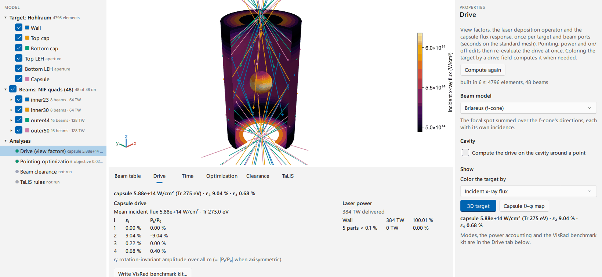

# Briareus.jl

[](https://github.com/stillyslalom/Briareus.jl/actions/workflows/CI.yml)
[](https://stillyslalom.github.io/Briareus.jl/dev/)
[](LICENSE)
[](https://github.com/JuliaTesting/Aqua.jl)

View-factor radiation and laser-pointing design for high-energy-density experiments:
indirect-drive hohlraums, backlighter foils and other laser-irradiated targets. Briareus
covers the core of what VisRad (MacFarlane, JQSRT 81, 287 (2003)) is used for (laser
deposition, 3D view-factor radiosity, capsule drive symmetry, synthetic x-ray images)
and reads and writes its files. Beyond that, deposition is differentiable, so pointing,
defocus, power balance and wavelength detuning are optimized with exact gradients; beam
clearance and NIF's target-configuration rules are checked on the worst case over
tolerances; and the drive is followed in time with laser–plasma corrections, a moving
wall, closing entrance holes and a synthetic Dante.



## Install

```julia
pkg> add Briareus
```

Briareus needs Julia 1.10 or later. The desktop application (BriareusGUI: target, beams,
drive, optimization and shot review in one window) is installed separately; see
[Desktop application](https://stillyslalom.github.io/Briareus.jl/dev/gui/) and
[BriareusGUI/README.md](BriareusGUI/README.md).

## First calculation

A NIF hohlraum driven by all 48 quads at 8 TW each, at an illustrative cone pointing
(aim height `z` and radial offset `r` per cone, mm; an example, not a shot's pointing).
Each ring of cones, inner (23.5° and 30°) and outer (44.5° and 50°), is then moved as a
whole along the axis and re-balanced in power to null the capsule flux's P2 and P4 at
the same mean flux, with the beams kept clear of the entrance-hole rims and the capsule:
four parameters, fixed at the optimum by the three targets and the entrance-hole
keep-out.

```julia
using Briareus

target = hohlraum(length = 10.1, radius = 2.875, leh_radius = 1.55, capsule_radius = 0.9)
cones = GroupPointing(nif_quads(power = 8.0); fields = (:z, :r))
quads = apply(cones, parameters(cones; inner23 = (z = 3.09, r = -1.09),
                                inner30 = (z = 3.63, r = -0.60),
                                outer44 = (z = 5.20,), outer50 = (z = 5.01,)))

ring(b) = b.group in (:inner23, :inner30) ? :inner : :outer
pointing = GroupPointing(quads; by = ring, fields = (:z, :power), relative = true)
scenario = Scenario(target, pointing; observe = :capsule)

x0 = initial_parameters(pointing)    # no aim shift, 8 TW per quad
report(evaluate(scenario, x0))       # 384 TW, Tr = 262.7 eV, P2/P0 = -15.737 %

drive = mean_flux(evaluate(scenario, x0))    # mean capsule flux, held fixed
keepout = (ApertureKeepOut(target), SphereKeepOut(target))
objective = symmetry_objective(modes = (2 => 1.0, 4 => 1.0); drive, keepout)
lower, upper = bounds(pointing, x0; power = 0.6)     # ±1 mm of aim, ±60 % of power
result = optimize_pointing(scenario, objective; x0, lower, upper)  # 20 iterations
report(evaluate(scenario, result.x)) # 422.1 TW, P2/P0 = -0.000 %, P4/P0 = +0.000 %
parameter_names(pointing) .=> result.x  # inner.z -0.135 mm, inner.power 3.97 TW,
                                        # outer.z +0.298 mm, outer.power 11.21 TW
```

The starting P2/P0 of −15.7 % is expected: equal power per quad puts 1/3 of it on the
inner cones, near HYBRID-E's peak cone fraction, and a static solve without cross-beam
energy transfer or the hohlraum's dynamics is not balanced there (the repository's
N221204 benchmark has a static P2/P0 of −26 % at 5.5 ns; the shot's balance comes from
wavelength-detuned transfer, wall motion, the gold bubble and closing entrance holes,
which `drive_history` models). The optimum lowers the inner-cone fraction to 0.15 and
stops where the 30° beams reach the entrance-hole keep-out; P6/P0 is left at +0.08 %.
After the package loads (1.6 s), building the scenario (deposition operator and view
factors) takes 2.5 s on 16 threads and the optimization 5 s on its first call (mostly
compilation) and 1 s after. `examples/nif_hohlraum.jl` runs the same case with a
ray-trace check. The [documentation](https://stillyslalom.github.io/Briareus.jl/dev/)
starts with tutorials that build up the physics and check each step against an exact
result; its home page has a short glossary (view factor, radiosity, P2/P0, LEH, cone
fraction, CBET).

Units are mm, ns, TW (TW·ns = kJ), TW/mm² (`to_Wcm2` multiplies by 10¹⁴) and eV; angles
are in degrees, θ from +z and φ counterclockwise from +x. A beam's direction is fixed by
its port, pointing moves its axis, and positive defocus moves the focus along the beam.

## What it does

- **Targets**: hohlraums, foils and windows on exact curved surfaces, or CAD (STL or
  VisRad-bundled) oriented, cut to the cavity, remeshed and fitted with its cylinders
  and spheres.
- **Beams**: NIF (per beam or quad, measured phase-plate spots) and OMEGA port tables,
  f-number cones, pointing, defocus, VisRad's beam profile.
- **Deposition**: a differentiable quadrature operator that conserves each beam's power,
  with an energy-conserving ray trace as its reference.
- **Radiation**: occluded view factors, gray or multigroup radiosity, Marshak wall loss
  and re-emission; Float32 and hierarchical matrices above 10⁴ elements.
- **Analysis**: Legendre and real spherical-harmonic moments integrated over each
  facet's solid angle, energy balance, rendered x-ray and laser images.
- **Optimization**: bounded L-BFGS-B on ForwardDiff gradients of aim, defocus, power,
  spot scale and Δλ per cone, quad or beam; robust design over beam errors; retuning to
  a reference shot's drive.
- **Laser–plasma corrections**: backscatter, a reduced kinetic CBET model calibrated to
  published HYDRA transfer, inner-beam absorption in the gold bubble.
- **Time dependence**: pulses, wall motion, entrance-hole closure, wall re-emission,
  capsule absorption, a synthetic Dante, the capsule drive for a hydrodynamics code.
- **Shot review**: worst-case beam clearance, TaLIS rules, unconverted light,
  entrance-hole keep-out as an objective, backlighter lines of sight and signals.

## Coming from VisRad

| VisRad | Briareus |
|---|---|
| Workspace (`.vrw`): components, bundled CAD, beams | `read_visrad_workspace`, `visrad_target`; `write_visrad_workspace` writes a design back |
| NIF SST pointing, Laser Beam Summary, power files | `read_visrad_sst`/`write_visrad_sst`, `…_summary`, `…_powers` |
| Beam profile away from focus | `VisRadProfile`, `visrad_profile(ws)` |
| Computed per-element deposition | `visrad_power_sources`, `visrad_deposition` |
| One case run in both codes | `write_visrad_kit`, `compare_visrad` |

## Verification and validation

- **Exact references**: the integrating-sphere flux to round-off, the defocused spot
  against the exact f-cone convolution (about 1 % of the beam power), the harmonics the
  NIF port symmetry forbids to round-off, gradients against finite differences.
- **VisRad**: on two NIF hohlraum workspaces, wall deposition 0.9 % rms per element from
  VisRad 21's, peaks within 0.5 %, capsule P2 and P4 within 0.014 and 0.004 points.
- **Monte Carlo**: LEH escape and capsule fractions agree with a photon walk in the
  exact N210808 geometry within its sampling error (10⁻⁴ of the source).
- **N221204** (Kritcher et al., PRE 109, 025204 (2024)), with nothing fitted to Fig. 10
  or to Dante: the capsule flux's P2/P0 swing reaches −0.181 at 5.25 ns and turns
  positive at 6.19 ns (Fig. 10: −0.170 at 5.6 ns, 6.67 ns); Dante 1 at 8 ns reads
  291–314 eV between the initial and open LEH areas, against 310 eV measured.

Each check, its kind and its location:
[Verification and validation](https://stillyslalom.github.io/Briareus.jl/dev/explanation/verification-validation/).

## Scope and limitations

Briareus is a geometric view-factor and ray-trace code with reduced laser–plasma
corrections. It solves no hydrodynamics: wall motion, LEH closure and the inner-beam
bubble are reduced models calibrated to published simulations and measurements, and the
radiosity is quasi-static, with no plasma energy store (after the laser falls, the
synthetic Dante reads 37–54 eV below the measured one at 9 ns on three shots). It does
not trace refraction. The CBET model assumes uniform LEH plasma and full pairwise
overlap; its unsaturated coupling overpredicts transfer, so calibrate it
(`calibrate_cbet`) before trusting magnitudes. Radiosity is gray unless `spectral_solve`
is used, which works about a gray solution. The `clearance` thresholds and wing models
are engineering defaults, not facility criteria.

## Facility data and provenance

| Data | Source | Notes |
|---|---|---|
| NIF quad ports | NIF User Guide §4.1, Table 4-1 | Port 63 is misprinted as 62 there. |
| NIF quad names, beam directions, CPP spots | LMF Shot RI Resources (2020), chamber-geometry figures | `data/nif_beams.csv`; spots converted from HWHM to 1/e. |
| NIF target-configuration rules | LMF "TCC Configuration Requirements" (2018) | [PDF](https://lmf.llnl.gov/sites/lmf/files/2023-05/TCC-configuration-requirements.pdf). The 0.5° tolerance (a component rotated off nominal) applies to the clearances; see `talis_check`. |
| OMEGA beams and phase plates | Truncated icosahedron reproducing the 21.4/42.0/58.9/81.2° cones; OMEGA Users' Guide (2014) | Azimuthal origin not tied to the chamber; real ports via `beams_from_table`. |
| VisRad formats and beam profile | VisRad manual (v21.1.1); VisRad 21 runs on NIF hohlraums and a beam-profile probe | |
| Published shot and simulation data | The cited papers, digitized or tabulated in `data/*.csv` with provenance headers | The research notes record which data each calibration was fitted to and which are checks only. |

`reference/research-notes.md` records the source and confidence of every default and
calibrated constant. The HYBRID-E pointing in the examples is an illustrative mock-up
(`hybride_mock_pointing`), not a facility pointing.

## Tests, citing, license

`julia --project=. -t auto -e 'using Pkg; Pkg.test()'` runs the suite
(`BRIAREUS_TEST_SHARD=1|2|3` a third of it; `BRIAREUS_LONG_TESTS=true` adds the Monte
Carlo and convergence checks CI runs). There is no paper yet: cite the repository, with
the metadata in [CITATION.cff](CITATION.cff). Briareus is MIT-licensed ([LICENSE](LICENSE)).
