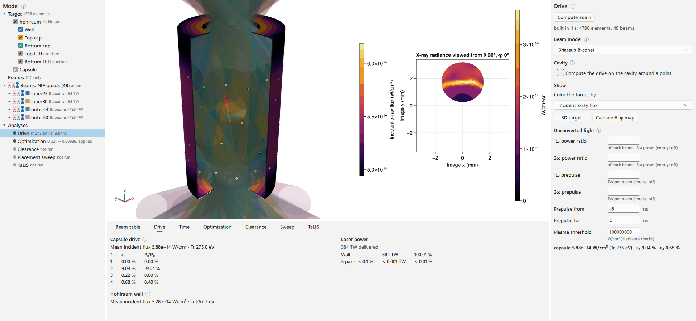
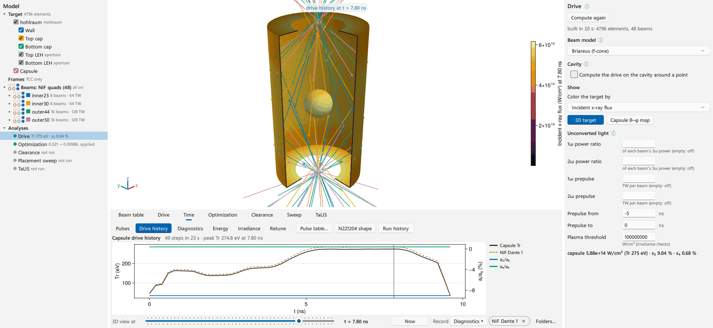
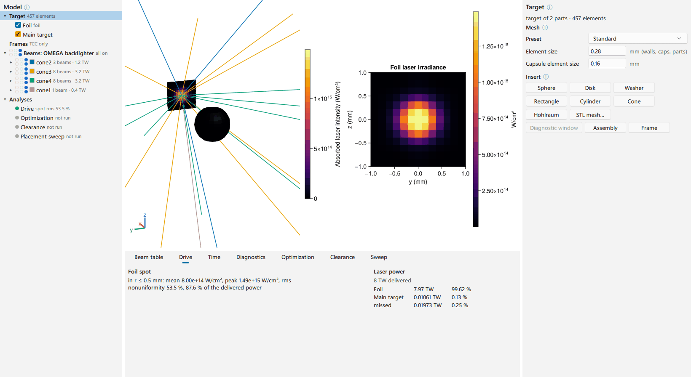
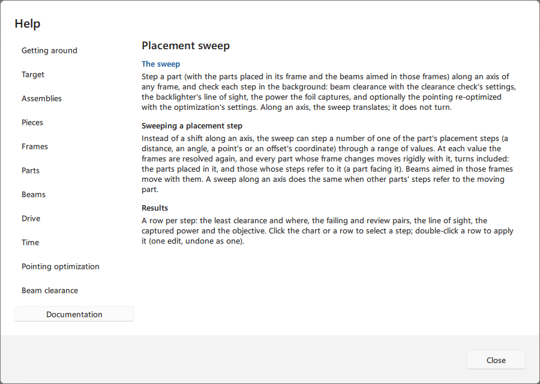
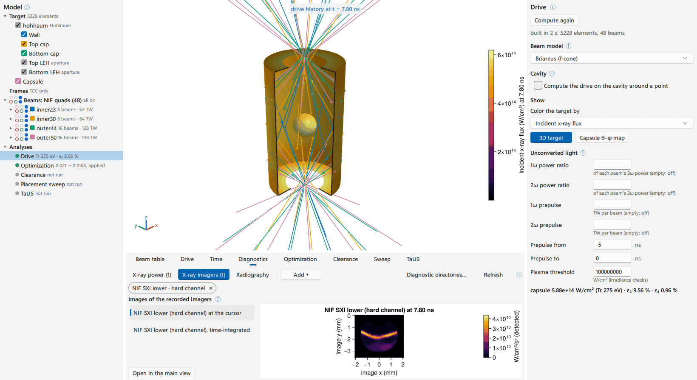

# Desktop application

The Briareus window (the BriareusGUI package and its `briareus` command) puts the
design loop of the library on screen in the manner of a CAD tool such as VisRad: a target is
built or imported, the beams are pointed, and the laser deposition, the x-ray drive and
the capsule drive symmetry follow every edit. The same window optimizes the pointing,
checks beam clearance from the target hardware and the NIF TaLIS target-configuration
rules, solves the drive through a pulse, and reads and writes VisRad pointing, beam
summary and workspace files. It serves target designers who would otherwise iterate in
VisRad, and anyone who wants the results of the library without writing a script; every
action in the window is a call into the same functions the scripts and tutorials use.


The window is laid out as a CAD tool: everything is reachable at any time, and each
analysis reports when its result is out of date.

## Install

### The `briareus` command

The command needs Julia 1.12.7 or later and no further Julia knowledge.

1. Install Julia through juliaup: on Windows `winget install --id 9NJNWW8PVKMN -e`
   (Julia from the Microsoft Store), on macOS or Linux
   `curl -fsSL https://install.julialang.org | sh`. Open a new terminal afterward.
2. Install the app and compile it (about ten minutes, once):

   ```
   julia -e "using Pkg; Pkg.Apps.add(\"BriareusGUI\")"
   ```

   or, in the package mode of the Julia prompt (`]`), `pkg> app add BriareusGUI`.
3. Put Julia's app folder on the `PATH` (the install prints a warning when it is
   missing). Windows, in PowerShell:

   ```powershell
   $p = [Environment]::GetEnvironmentVariable("Path", "User")
   [Environment]::SetEnvironmentVariable("Path", "$p;$HOME\.julia\bin", "User")
   ```

   macOS (zsh): `echo 'export PATH="$HOME/.julia/bin:$PATH"' >> ~/.zprofile`; Linux
   (bash): the same line appended to `~/.bashrc`. Open a new terminal afterward.
4. Add Briareus to the desktop and the applications menu: `briareus --shortcut`. On
   Windows this makes Start-menu and desktop shortcuts, on macOS
   `~/Applications/Briareus.app` (listed by Launchpad and Spotlight), on Linux a menu
   entry.

The shortcut, or `briareus` in a terminal, then opens the window on a fresh design, and
`briareus design.briar` opens a saved session. The window takes about 20 s to
open (the first start after an update compiles for a few minutes). A shortcut shows a
splash within about a second meanwhile; `briareus` in a terminal shows nothing until
the window, since the code of the command runs only once BriareusGUI and its graphics
libraries have loaded. The command runs Julia on all threads (`--threads=auto`) and
returns when the window closes. A shortcut has no terminal: its output goes to
`%LOCALAPPDATA%\Briareus\briareus.log` (on macOS, `~/Library/Logs/Briareus/`), and a
failure to start shows in the splash with the location of the log.

`briareus design.briar --tab talis` opens the window on a results tab (`beams`, `drive`,
`time`, `diagnostics`, `optimize`, `clearance`, `sweep` or `talis`), so a session written
by a script is checked by eye in one step.

The command also runs without a window. A design is a saved session or a VisRad
workspace (`.vrw`), and each command writes files that open without Briareus:

```
briareus talis design.vrw --out talis.csv --json       # the TaLIS checks; exit code 2 when a check fails
briareus review-1w design.briar --out review/          # the 1ω review: HTML, CSV, one SVG slice per tight pair
briareus roe design.briar --out roe/ --json            # the beam rules of engagement: HTML, CSV, Markdown, port map
briareus run script.jl args...                         # a script with Briareus and the controllers loaded
```

`review-1w` takes `--threshold` (mm, default 1.0) for the margin below which a passing
pair is drawn. The checks run with the settings saved in the design, through
`Briareus.talis_check`, `Briareus.omega1_review` and `Briareus.roe_scan`, so a script
that calls those functions gets the same numbers. `roe` scans the drive scenario of the
design against the criteria that `Briareus.roe_default_criteria` selects from the
observed part and the foils, lists them in the sheet, and applies to a design without a
hohlraum. These thresholds are engineering defaults, and a shot sheet needs the criteria
of the experiment, passed to `roe_scan` from a script. The commands load the same
package as the window, which takes most of their time.

`pkg> app update BriareusGUI` updates the app, and `pkg> app rm BriareusGUI` removes it
(the shortcuts are deleted by hand). A shortcut runs a script that names the Qt
libraries of the installed app for its splash, so `briareus --shortcut` is run again
after an update.

### From Julia

The window opens from any Julia session started with several threads
(`julia -t auto`), so that background jobs leave it responsive:

```julia
pkg> add BriareusGUI

julia> using BriareusGUI

julia> sess = briareus()                   # or briareus(resolution = :fine)
```

`briareus` blocks while the window is open (Qt runs its event loop on the calling
thread) and returns the session when it closes. The window needs a graphical session,
and it cannot share a process with a GLMakie window or an offscreen GLMakie render.

### From a development checkout

BriareusGUI lives in the `BriareusGUI/` directory of the Briareus repository; its
environment takes Briareus from the checkout once that is developed into it:

```
git clone https://github.com/stillyslalom/Briareus.jl
julia --project=Briareus.jl/BriareusGUI -e "using Pkg; Pkg.develop(path=\"Briareus.jl\")"
git -C Briareus.jl checkout BriareusGUI/Project.toml
julia --project=Briareus.jl/BriareusGUI -t auto -e "using BriareusGUI; briareus()"
```

`Pkg.develop` also writes a `[sources]` entry into `BriareusGUI/Project.toml`, which the
`git checkout` discards (the developed copy stays in the manifest). The package has no
`[sources]` entry: an app installed from the registry would keep the path `..` of the
entry, which exists in the installed tree but has no package in it, and the install would
fail. The `briareus` command installs from the checkout with
`julia -e "using Pkg; Pkg.Apps.develop(path=\"Briareus.jl/BriareusGUI\")"`.

## A first session

The steps below design the drive of a NIF hohlraum from the *Hohlraum with capsule*
starter. Each step names the menu entries, and the panels are described in [The
window](@ref).

1. **Open.** `briareus` opens on the *Hohlraum with capsule* starter, a hohlraum part
   and a capsule sphere, with the 48 NIF quads at illustrative example cone aims
   (`nif_quads`). The model tree lists the hohlraum part with its pieces under it (wall,
   caps and entrance holes), the capsule, the beams by cone and quad, and the analyses.
2. **The target.** Selecting the hohlraum part in the tree shows its dimensions and wall
   material in Properties, and *Target* shows the mesh. Target ▸ Mesh sets the element
   sizes. Its presets come from a work-precision study on the NIF hohlraum
   (`examples/mesh_convergence.jl`) and give the capsule P2/P0 and P4/P0 to about 0.5
   (coarse), 0.1 (standard) and 0.02 (fine, converged) percentage points.
3. **The beams.** Selecting a cone (a group) in the tree shows its aim, defocus and
   power, which apply to all its quads. A quad or a beam is edited the same way, and the
   *Beam table* tab lists every one of them. View ▸ Beams ▸ Volumes draws the 5% contour
   of each beam along its f-cone, cut where it meets the target, so a beam clipping an
   entrance-hole lip or the capsule shows at a glance.
4. **Compute the drive.** Compute ▸ Drive (Ctrl + R), or coloring the target by a drive
   field (View ▸ Color target by ▸ Incident x-ray flux), computes the view factors on a
   worker thread in seconds on the standard mesh. From then on a beam edit re-evaluates
   the drive at once, because the view factors depend only on the target and the beam
   ports.
5. **Read P2/P0.** The *Drive* tab lists the capsule mode amplitudes ε₁…ε₄, the Legendre
   ratios ``P_l/P_0``, and the laser power accounting as [`report`](@ref) prints it. The
   accounting gives the power absorbed in the wall, on the outer faces of the caps and
   on the capsule, the parts below 0.1% of the delivered power on one line, and the
   light that misses the target. For a foil the tab lists the spot statistics instead.
   *Capsule θ–φ map* in the drive properties (or View ▸ Capsule θ–φ map) puts the
   capsule flux map in place of the 3D view. On the starter at equal power per quad, an
   inner-cone fraction of 1/3, P2/P0 starts near −15%. A static solve without cross-beam
   energy transfer or the hohlraum dynamics is not balanced at a fielded cone fraction:
   the static P2/P0 of the N221204 benchmark at 5.5 ns is −26%, and the shot is balanced
   by wavelength-detuned transfer, wall motion, the gold bubble and closing entrance
   holes.
6. **Optimize.** Compute ▸ Optimization selects the optimization task, which has three
   parts:

   - the free parameters, which are the aim, defocus and power per cone, quad or beam
     within ± bounds;
   - the objective, which is axisymmetric ``P_l`` or all-m 3D modes (optionally with the
     drive level held), the RMS nonuniformity of a flat observed face
     ([`face_flux_objective`](@ref)) for a halfraum package or an opacity sample, or the
     nonuniformity of a foil spot; the face objective is relative to its start, so that
     a weight of 1 balances it against the penalties on any face;
   - the keep-outs.

   *Optimize* starts [`optimize_pointing`](@ref) in the background with progress and
   Cancel. The tab then compares the modes, the clipped power and the capsule clearance
   before and after, and lists every parameter against its bounds, with a mark on each
   parameter at a bound. *Apply result* writes the optimized pointing to the beam table,
   and the model tree marks the result out of date once the beam table changes.

   

7. **Check clearance.** Compute ▸ Clearance computes the worst-case beam-to-hardware
   clearance over pointing, positioning and focus errors. Compute ▸ TaLIS checks the NIF
   target-configuration rules, on NIF beams only. Both run in the background and color
   the beams by their worst status, and a result is marked out of date in the tree when
   the beams or the target change afterward.

   

8. **Save.** File ▸ Save session (Ctrl + S) writes the whole design, from the target to
   the settings of the analyses and the view, to a `.briar` file. The file is a zip
   archive of the design as TOML and a copy of every CAD file the design reads (STL
   parts, VisRad workspaces), so it opens on another computer. File ▸ Save session
   without CAD files writes only the TOML (`.briar.toml`, with CAD files by path), for
   CAD that is not to travel with the design. File ▸ Open session (Ctrl + O), or
   `briareus design.briar`, reads either back, and results are computed again on load.
   The design reads the CAD copies saved with it. A source file that changed on disk
   since the save is offered in its place, and the properties of a part can relink its
   file or read it from the source again.

   A session file is loaded in the current format only. A file of another format
   version is refused with an error that names the version found and the version
   supported, and earlier formats are not converted.

   A session also contains the definition of each diagnostic it records (see
   *Diagnostics* below), CSV files included, and its histories use those definitions
   wherever the session is opened. A saved definition that differs from the definition
   of the same id in the diagnostic directories is marked `*` on its chip. The tooltip
   of the chip names the differing keys, and its menu switches to the definition in the
   directories. After a save, the status line names the definitions from outside the
   built-ins and those that are not public, which are then stored in the file.

   Edit ▸ Undo (Ctrl + Z) and Redo (Ctrl + Y) step through every edit of what a session
   saves, in one history. The history covers design edits, whether typed, chosen from a
   menu, read from a file or applied from an optimization, as well as loaded pulses and
   changes of the view: display modes, the cutaway, the beam drawing, hidden beams and
   frame axes. An undo therefore takes back the last thing done, and the view state of a
   part follows the undo of its rename. The camera, the selection and the diagnostics
   added for a drive history are not steps, and an undo of a view change leaves the
   target as it is.

   A session also saves the window as it was left, so it reopens the same way. The saved
   state includes the camera pose and projection, whether the drive shows the 3D view,
   the map or the x-ray image (with the image camera), and the chart of the Time tab.

Two further steps use the view factors of the drive without computing them again: an
x-ray image of the target (Compute ▸ X-ray image along the view) and the drive through a
pulse (the *Time* tab).





A backlighter design starts from File ▸ New target ▸ Backlighter foil, which loads the
OMEGA backlighter beams. The *Backlighter foil* starter is a foil part with the foil
role, 6 mm from TCC and facing it, and an absorbing sphere at TCC that stands in for the
main target. The drive then reports the mean and peak intensity of the foil spot, its
nonuniformity and the fraction of the power inside the spot, and the optimization offers
the foil-uniformity objective.



## The window

### Model tree

The left panel lists the parts of the target with a swatch of their color in the 3D
view, so the tree is the color key. A hohlraum part lists its pieces under it (wall,
caps, entrance holes and diagnostic windows), followed by the capsule and other parts.
The tree also lists the beams by group, quad and beam, and the analyses (drive,
optimization, clearance and TaLIS) with their state. Selecting a node selects it in the
3D view and shows it in Properties. Ctrl + click adds components or beams to the
selection and Shift + click adds a range, which Properties then edits together and the
3D view highlights together. Esc clears the selection, and a double click fits the view
to it. A right click on a row opens its commands, only those that apply to it. *Remove*
takes out every selected part, assembly, frame and window in one edit
(`Controllers.remove_nodes!`). An assembly goes with its contents. What was placed in a
removed frame, such as a capsule in the frame of its hohlraum, stays where it is and is
placed in the nearest frame above that remains, and beams aimed in a removed frame keep
their aim points. Removing every part leaves an empty target.

Taking part in the calculations and being drawn are separate settings. Each beam row
shows VisRad's 2 × 3 matrix of dots. The top row shows whether the 1ω (red), 2ω (green)
and 3ω (blue) light of the beams takes part in the calculations, and the bottom row
whether it is drawn. A filled dot is on, a ring is off, and a pale dot is on for some of
the beams. A click switches the dot for the beams of the row, or for the whole selection
when the row is in it, and the beam properties show the same matrix as check boxes. 3ω
participation switches a beam on or off, and only beams that are on enter the drive, the
clearance check and the optimization. A beam can be hidden to show the surface it
lights, or its unconverted light can be drawn while the beam stays out of the way,
without changing any result. The unconverted 1ω and 2ω light is drawn for NIF quads and
beams as `unconverted_deposition` deposits it. For each beamlet the drawing shows the
`nif_unconverted` footprint square at the 3ω best-focus plane, displaced toward the
position of the beamlet in its quad, and the square beam converging to its focus.
Outlines and center lines are drawn as rays and the converging beam as a volume. View ▸
Beams switches the drawn 1ω light from the nominal footprint to the 10% contour that the
TaLIS rules measure to, or to that contour grown by the default errors and clearance
([`omega1_contour`](@ref)); the choice changes the drawing only. The
participation dots of a color switch once the drive has a power ratio for that color
(below).

![The beam matrix in the model tree. Each beam row shows 2 × 3 dots for 1ω, 2ω and 3ω, with the top row for participation in the calculations and the bottom row for drawing, and the properties of the inner quad Q15T show the same matrix as check boxes. With illustrative 1ω and 2ω power ratios of 5% each, the unconverted light of Q15T is drawn, with the outlines and center lines of each color as rays, while only its 3ω light takes part in the calculations. The rows of its group and of all the beams show the 1ω and 2ω drawing dots pale, on for one of their beams.](assets/gui/beam_matrix.png)

Each component has a box in its color that shows or hides it. The fill of the box shows
the display mode: solid for opaque, pale for semi-transparent, an outline for wireframe,
and empty when hidden. The context menu and Properties ▸ *Display* set the mode to
opaque, semi-transparent, wireframe or invisible. A click selects through
semi-transparent and wireframe components to an opaque one behind them. *Include in
calculations* is a separate setting. A component left out is drawn as a gray ghost and
removed from the target, which becomes an open enclosure, and beams left out are
switched off.

### Properties

The right panel edits the selection. A value the geometry or a check rejects is refused
with the reason in the status line. The pages contain controls and short status lines,
and tooltips are one-line hints. An ⓘ beside a page title, a section heading or a
control shows such a hint on hover and, when clicked, opens its explanation in the Help
window (Help ▸ Help, F1). The Help window is separate, resizes and stays open beside the
design, and contains the explanations by page, a search field, and the mouse and key
bindings. Help ▸ Documentation opens this page.



- **Target:** the mesh, set by a preset (above) or by element sizes in mm for the walls
  and parts and for the capsule. A target is made of parts. File ▸ New target starts
  from a ready-made target, listed under the facility it is a mock-up for, and loads the
  beams of that facility; imported beams are kept. The NIF starters are *Hohlraum with
  capsule*, *Frustraum with capsule* (a hohlraum part with a frustraum profile),
  *Halfraum pair with shock tube* and *Opacity halfraum*. In the halfraum pair, two
  halfraums face each other across a cylinder package whose end faces close them, and
  the top face is observed; the opacity halfraum has an observed sample foil in its open
  end. The OMEGA starter is *Backlighter foil*, and *Empty* has no parts at all. The
  dimensions are illustrative mock-ups. The Insert menu (and the target properties) adds
  spheres, disks, washers, rectangles, cylinders, cones, bare hohlraum parts and STL
  meshes, placed at TCC. It also adds diagnostic windows in the wall of the selected
  hohlraum part, assemblies of the selected parts and frames. (`insert_starter!` still
  adds the parts of a starter to a design from a script.)
- **Hohlraum parts:** a cylindrical hohlraum ([`hohlraum`](@ref)) along the z axis of
  the part, in pieces named after the part (`hohlraum_wall`, `hohlraum_cap_top`, …). The
  properties are its length, radius, entrance-hole radius (the bottom hole radius may
  differ), wall albedo and conversion, the closing entrance holes and its windows. Each
  end is an entrance hole, closed by its cap or open. An open end has neither cap nor
  hole, as in a halfraum, and is closed or not by whatever is placed there. The cavity
  of each hohlraum part consists of the part pieces and the elements of other parts
  inside it that face into it, such as a capsule or a package face closing an open end.
  Its view factors are balanced separately when under 1% of its rays leave it, and
  elements in no cavity keep their raw view factors. The wall and caps have the *Wall*
  role, which gives the wall temperature of the drive history. The clearance and TaLIS
  checks treat the caps, which form the edges of the entrance holes, as hardware.
  The row of a piece in the model tree (its properties, or the right-click menu) gives
  the piece another role. A cap can be *Observed*, which gives it a face map and flux
  statistics and takes it out of the walls of its cavity; a wall section or a cap can be
  *None*, and a closed window *Wall*. The entrance holes, their lips and open windows
  are apertures and take no role. Each end has a frame (`hohlraum.leh_top`,
  `hohlraum.leh_bottom`) with its origin at the center of the end and z pointing out of
  the hohlraum, so one placement or aim mirrors between the two. Each window has a frame
  at its center on the wall (`hohlraum.window_1`). The *Profile* of the part is a
  cylinder, a frustraum or sections. A frustraum is two cones meeting at the waist, set
  by the waist radius and the radius of each end ([`frustraum_profile`](@ref)). Sections
  are a table of breaks, each a height and a wall radius, with the end breaks at
  ±length/2 ([`HohlraumProfile`](@ref)). The wall is then one piece per section
  (`hohlraum_wall_1`, …), each with the *Wall* role, and windows go in cylindrical
  sections only.
- **Windows** ([`WallWindow`](@ref)) in the wall of a hohlraum part (Insert ▸
  *Diagnostic window*, or its properties ▸ *Add window*): azimuth, height, round (the
  default, with the exact disk area) or rectangular shape, and open or closed with their
  own albedo and conversion efficiency. Overlapping windows, or a window past the end of
  the wall, are refused.
- **Parts:** spheres, disks, washers, rectangles, cylinders and cones placed anywhere,
  with their own albedo, conversion, sidedness, aperture flag and element size, for
  hardware such as shields, stalks, detector apertures and second foils. A part is
  placed in a named frame ([`Frame`](@ref), resolved with [`resolve_frames`](@ref)). The
  frame is the chamber frame, the frame of another part, or the end or window frame of a
  hohlraum part. The frame of a part has its origin at the part center and z along its
  axis; on a foil, z is the front normal. A part moves and turns with its frame when the
  part that defines the frame changes. Its position is given in Cartesian, cylindrical
  or spherical coordinates of that frame ([`coords_of`](@ref)), and its orientation by
  the axis polar and azimuth angles and a rotation, in VisRad's order
  ([`euler_rotation`](@ref)). Changing the frame leaves the part where it is.

  The *Move along* row steps the part by ± a distance along the x, y or z axis of any
  frame, one edit per click; z of the part frame is the axis of the part. Parts placed
  in its frame and beams aimed in that frame move with it. *Sweep along this axis…* sets
  up a placement sweep of the part along that axis (below).

  *Placement steps* then place the part relative to other frames, in order
  ([`PlacementStep`](@ref)). The steps are coincidence with a point, lying on or
  concentric with an axis, a distance from a point, facing a point, being parallel to an
  axis, a roll from a direction, and relative offsets and rotations. The heading of each
  step names what it fixes. A step that undoes an earlier one is refused, with both
  named ([`placement_report`](@ref)), and the degrees of freedom that no step fixes take
  the values of the placement fields. A new step starts with the part where it is, at
  the current point, distance and roll. The part follows the frames its steps refer to,
  as it follows the frame it is placed in.

  A *mesh* part reads an STL file (Insert ▸ Mesh from STL file), scaled to mm, with its
  windings repaired ([`orient_mesh`](@ref)) and its surface remeshed into elements of
  the part element size ([`remesh_mesh`](@ref)). A multi-body ASCII STL of named solids
  gives one part per solid. A *VisRad object* part is a component of an imported VisRad
  workspace; a VisRad rectangle, sphere or cylindrical hohlraum retains the VisRad element
  grid unless the part is given an element size.

  The *Role* of a part marks it for the analyses, and the part name is unchanged. The
  roles are:

  - *Observed*, the surface whose x-ray drive is analyzed, one at a time. A sphere gives
    the capsule modes, θ–φ map and keep-out that the drive and optimization take. A flat
    face, such as a rectangle or disk for a package face or an opacity sample, gets a
    map of its incident flux over the face, its mean, range and RMS nonuniformity, and
    no capsule modes. A CAD capsule is replaced in the calculations by a sphere fitted
    to it (`fit_sphere`), so a fill tube does not count.
  - *Backlighter foil*, a flat part or a mesh.
  - *Wall*, a re-emitting cavity surface. It enters the wall temperature of the drive
    history, and the clearance and TaLIS checks treat it as a surface the beams land on,
    as for the wall of a hohlraum part.
  - *Thin film*, which is left out of the drive cavity (below).

  Any number of parts can be foils or walls. The *active foil* is chosen with Drive ▸
  Active foil, or with the check in the part properties shown when there are two or more
  foils. Its spot statistics, map and objective are used by the drive and the
  optimization, and its line of sight and captured power are checked by the sweep. The
  clearance and TaLIS checks treat every foil as a surface the beams land on. The model
  tree marks the foils, and the active one among several.

- **Frames:** the Frames folder of the model tree contains user frames, named frames
  without geometry that are placed like parts by origin, axis angles, rotation and
  placement steps, in any frame. Insert ▸ *Frame* or *Add frame* in the folder places
  one in the selected frame. Parts are placed in a user frame, beams aim in it and a
  sweep steps it, as for the frame of a part. When a frame is removed, what was placed
  in it stays where it is. A *port frame*, set on the page of the folder for a port of
  the beam table or a NIF quad at the angles of [`port_angles`](@ref)`(:nif, quad)`, has
  its origin at TCC and z toward the port ([`port_frame`](@ref), VisRad's
  diagnostic-port axis); only its roll is edited. Tools ▸ *Coordinate transform* gives
  the coordinates of a point or direction in any frame from those in another
  ([`transform_point`](@ref)), Cartesian, cylindrical or spherical, and *Create frame*
  makes a user frame there. The 3D view draws the axes of the selected frame (x red, y
  green, z blue, with its name) and those of the frames switched on in their page or
  menu.
- **Beams** (a group, quad, beam, or any Ctrl-selected set): the aim, defocus, power and
  on/off state, and where the axis lands. The aim is given relative to the ports (z, r
  and a tangential offset), or as a common aim point (x, y, z) in the *Aim frame* of the
  beams, as VisRad points a cluster at a reference point. The aim frame is the chamber,
  a user frame, a part, or the end (its entrance hole and cap) or a window of a hohlraum
  part, listed after their part. The beams keep their coordinates in that frame when it
  moves or turns, so an aim 0.3 mm off the center of a foil stays 0.3 mm off it, and
  when the part is renamed or given a role. *Aim at the frame's center* points them at
  the center of the frame, which for a part is its centroid. The OMEGA backlighter beams
  aim in the frame of the active foil. *Look along beam* views the target from the port
  of the beam.

  Beams belong to groups, as VisRad's clusters do: the cone by default, or any named set
  ("backlighter") made with *Move to group*. A group is edited, switched and optimized
  together, and its members keep their cone for the laser–plasma models. A NIF quad held
  as one beam splits into its four beams, each with a separate port and a quarter of the
  power, so that the laser deposition is computed per beam. It merges back from the
  right-click menu of the row or the Beams menu, for one quad, the quads of a group or
  every quad at once. The quad stays the unit of pointing and power either way. Its row
  edits its beams together, and the radial and tangential aim offsets are measured in
  the port azimuth of the quad ([`GroupPointing`](@ref)'s `unit = :quad`). The beams of
  a quad with the same values therefore share one aim point, the point that the quad
  held as one beam aims at, to under a micron; the mean of the four ports of a quad is
  the quad port to 0.004°. Measured in the azimuth of each beam, the aims of a 23.5°
  quad would land 0.2 mm apart per mm of aim r. The row of a cone or a quad, the
  192-beam preset and the optimizer per cone or per quad keep one aim point per quad,
  and the beams of a quad are pointed apart only from their individual rows. A click on
  one of the beams of a quad in the 3D view selects the quad while its row is closed in
  the tree. The power of rows of whole quads is given per quad
  (`Controllers.power_unit`), so a split leaves the numbers in the Beam table unchanged.

- **Facility** (Beams ▸ Facility, or the Beams properties): NIF, OMEGA, OMEGA EP or
  Other. The facility sets the beams, the presets offered, the instruments the
  Diagnostics tab lists and the checks; the TaLIS rules are NIF's. The first preset of a
  facility replaces the preset beams of another. OMEGA EP and Other have no built-in
  set, so the preset beams of another facility are taken out and a beam table is
  imported; imported beams are kept. The NIF presets are quads or beams at illustrative
  example cone aims; in the holes of a frustraum, the aims are derived from them to keep
  the spot of each cone at the same fraction of the wall height where the hole allows.
  The OMEGA presets are the hohlraum and backlighter sets.
- **Analyses:** the settings and Run of the drive, the optimization, the clearance
  check, the placement sweep and the TaLIS rules.

### 3D view

The center canvas navigates as a CAD tool:

- the wheel zooms toward the point under the pointer;
- a left or middle drag orbits about the selection or the point under the pointer;
- a right drag, Shift + drag or Ctrl + middle drag pans;
- a click selects a component or beam, and a double click fits it;
- `f` fits everything, and the arrow keys orbit by 15°.

The near and far planes follow the eye, so nothing is clipped however close the view.
The View menu contains the standard views, a perspective or orthographic projection,
turntable (z up) or free rotation, the cutaway, Look from port (the port of a beam or
any θ, φ) and Save view as image. Switching the turntable back on levels a view that a
free rotation rolled. Help ▸ Mouse and keys lists the bindings.

A placement triad is drawn on the selected part, piece or assembly, in the axes of the
frame it is placed in (Properties ▸ *Placed in*). A drag on an arrow moves the part
along that axis in whole multiples of the *Move along* step. A drag on a square, one
between each pair of arrows, moves it in that plane, each component in those steps, as
one move. A drag on a ring turns it about that axis, through the origin of the part, in
15° steps, and Ctrl held at the press snaps to a tenth of either. The handle under the
pointer is drawn brighter and thicker. While dragging, the view previews the moved parts
and the beams aimed in their frames. The release makes one edit (`nudge_part!` or
`turn_part!`, the edits of the *Move along* buttons), undone as one, so the placement
stays parametric and the beams aimed in the moved frames follow. A press on a handle
released without moving is a click, and the triad is hidden when nothing, several things
or a beam is selected.

The cutaway is a pie slice or a section plane through the chosen components. The context
menu of the Cutaway button offers presets, the components cut, and *Cut settings…*. A
slice has a center azimuth and a width about the x, y or z axis, optionally bounded
along it. A section plane removes the side its normal points to. Its normal is a preset
(x, y, z, toward the view), typed port angles θ and φ, or a typed vector; the port
angles follow the Briareus convention, with θ from +z and φ from +x toward +y. The plane
passes through a typed point (TCC by default), moved along the normal by an offset
slider, and *Flip* selects the other side of the same plane.

A plane can also come from the geometry:

- *Through* the selected component puts the point at its centroid and, for a flat
  component such as a window, foil or disk, takes its mean normal.
- *Facing it* turns the normal toward a direction, a beam port picked from the table or
  typed θ, φ.
- *Containing the line of sight* lays the plane along the line from TCC or the centroid
  of the selected component toward that direction, turned about the line by a rotation
  slider. At 0° the plane is vertical, and at 90° it contains the horizontal
  perpendicular to the line. This is the section through a diagnostic window along its
  view, and the cut halves the window along the line of sight of the diagnostic.

The plane, its point and offset, and the line and rotation are saved with the session.
Cut components are clipped exactly at the cut, without whole elements removed: each
triangle is split by the planes that bound the removed region, the pieces outside it are
kept and colored as their element, and the edges of the cut are outlined. A slice
narrower than 180° removes the intersection of two half-spaces, so what remains is a
union that one set of GPU clip planes cannot express; splitting the triangles also keeps
picking and the outline exact.


Beams are drawn as rays or as volumes. A ray runs along each axis from the lens side to
the surface it reaches, with the aim point marked. Beams are colored by group or by
their worst clearance or TaLIS status, in the colors of the tree. The target is colored
by component or by the absorbed laser intensity, the x-ray radiosity or the incident
x-ray flux (W/cm²); a drive coloring computes the drive when it is missing. Two further
views share the canvas. One is the capsule θ–φ flux map, or the foil face for a foil.
The other is an x-ray image (Compute ▸ X-ray image along the view, `xray_image!`), the
radiance of the surfaces seen along the direction of the 3D view, framed as the view
frames them and seen through transparent apertures, so a hohlraum is imaged inside
through its entrance holes. The image follows the drive as beams are edited. View ▸ Map
or image beside the 3D view shows either view in a second canvas next to the target.

### Results

The bottom panel has the following tabs.

- **Beam table:** every cone, quad or beam with its pointing, defocus, power, on/off
  state and the frame its aims are held in, edited in place. A click on a column heading
  sorts the rows; a second click sorts them in descending order, and a third restores
  the order of the table. The sorting is a display order only, and the order of the
  beams in the design and the session is unchanged.
- **Drive:** the view factors are computed once per target and beam ports, on a worker,
  and beam edits then re-evaluate the drive at once. The tab shows the capsule mode
  amplitudes and ``P_l/P_0``, the foil spot statistics and the laser power accounting. A
  VisRad benchmark kit for the same case is written from a script with
  [`write_visrad_kit`](@ref).

  The Drive properties take the unconverted 1ω and 2ω power as fractions of the 3ω power
  of each beam. An empty field is off, and there is no default, because the NIF User
  Guide does not give a fraction. The beams whose 1ω or 2ω dot is on in the calculations
  row then add the absorbed power of [`unconverted_deposition`](@ref) to the 3ω
  deposition wherever that deposition enters, which covers the absorbed-laser coloring,
  the power accounting, the back-side losses and the x-ray source. The unconverted
  totals are listed separately. The absorption and x-ray conversion of the unconverted
  light are scaled by the wavelength factors `absorption` and `conversion` of
  [`nif_unconverted`](@ref), relative to 3ω (see [`UnconvertedColor`](@ref)). Its x-ray
  source is the conversion efficiency of the material times the `conversion` of the
  color. The drive history and the retune take the unconverted light of the same beams
  (`drive_history`'s `unconverted`, a fraction per beam where the light of only some
  beams takes part), and the pointing optimization uses only the 3ω light. - **Time:**
  the drive through a pulse. *Pulses ▾* sets the pulses the beams fire. They come from a
  pulse table ([`read_pulse_table`](@ref)) of power against time per cone group, quad or
  beam, in which disabled beams stay off, or from a published shape
  (`Controllers.PULSE_SHAPES`). The published shapes are the delivered total power of
  N221204 ([`n221204_pulse`](@ref Briareus.Benchmarks.n221204_pulse)) and of N191118 and N210601
  ([`zylstra2022_fig2`](@ref Briareus.Benchmarks.zylstra2022_fig2)), with each beam reaching its set power at the peak. A
  table column for a cone or a quad is the power per quad, shared by the beams of that
  quad in the table, so the pulses fire the same total whether quads are split or not.
  The box beside *Pulses ▾* switches the columns to the power per beam
  (`Controllers.PULSE_UNITS`; `with_pulses` itself takes a table per beam), and the
  retune reads its reference table and writes its result in the same unit. A session
  saves the pulses, including the table data, so it opens without the CSV file.

  *Run history* solves the drive at each time of the pulses on the view factors of the
  drive ([`drive_history`](@ref)), and every 0.5 ns over the prepulse window (below).
  The x-rays of the prepulse thus heat the wall and capsule, and the wall carries that
  heat into the main pulse. A time between two times that fire, where nothing fires, is
  solved as a zero-power step, in which the wall re-emits what it stored. The
  diagnostics added in the Diagnostics tab (below) are recorded with the history.

  Five charts are drawn in the colors of the tree:

  - *Pulses*, the power of each group and the total, in TW;
  - *Drive history*, the Tᵣ of the capsule and of each recorded diagnostic
    ([`dante`](@ref)) in eV, with a₂/a₀ and a₄/a₀ in % on the right axis; for a flat
    observed face it plots its Tᵣ from the area-mean flux, and its RMS nonuniformity and
    peak and lowest flux relative to the mean on the right axis;
  - *Energy*, the laser energy delivered by each time and where it went, in kJ
    ([`energy_budget`](@ref));
  - *Irradiance* and *Retune* (both below).

  On the *Irradiance* chart, *Run checks* computes the irradiance histories of the
  unconverted 1ω and 2ω light on the target of the drive
  ([`unconverted_history`](@ref)). The histories use the ratios set in the Drive
  properties, on the beams whose light takes part, plus the prepulse. The chart plots
  the peak on each part against the plasma threshold on a log axis, with the 3ω peak on
  the active foil. Above the chart, one line per check reports pass or fail. *Specular*
  ([`specular_check`](@ref)) passes when every surface part stays below the threshold,
  and otherwise reports the first crossing ([`threshold_crossing`](@ref)). On a target
  with a foil, *Pre-plasma* ([`preplasma_check`](@ref)) compares the onset of the
  unconverted light on the foil with the arrival of the 3ω light at the foil, from
  [`irradiance_history`](@ref).

  The Drive properties set the prepulse and the threshold. The prepulse is a 1ω and a 2ω
  power per beam, flat over a window from -5 to 0 ns by default (`drive_history`'s
  `prepulse`, also taken by the drive history and the retune). The threshold is 10⁸
  W/cm², the NIF User Guide's guideline for the onset of plasma on a metal, used as an
  engineering default. The row under the chart sets what the 3D view shows. *Beam
  powers* shows the drive at the powers set on the beams, and *Drive history* shows a
  step of the history, chosen with the slider or a click or drag on the chart, on one
  color scale for the whole history; scrubbing computes nothing. A beam, pulse or target
  edit marks the history out of date. File ▸ Export results writes a current history
  with the drive (`Controllers.export_history`): the drive, the energy and each recorded
  diagnostic against time, the fields per element at every step, and the images from the
  imagers. - **Diagnostics:** the synthetic diagnostics a drive history records, by
  category (x-ray power, x-ray imagers and radiography). *Add ▾* lists the instruments
  of the category at the facility of the session. They come from the diagnostic
  directories ([Diagnostic definitions](reference/diagnostics.md)), which are the
  built-ins followed by the directories set in Diagnostics ▸ Diagnostic directories… and
  kept for later sessions, and from the definitions saved with the session. An
  instrument is listed once, whatever the number of its definitions; the definitions
  share an `instrument` key, as the Dante 1 channel sets of several years and shots do.
  Each instrument is recorded in one configuration, which is changed from the menu of
  its chip (right click or double click). NIF Dante 1 is recorded in a new session, and
  an instrument that cannot be built cannot be added; Dante 2 is an example, because its
  channels are not public. The dialog of the directories lists the problems found in the
  definitions ([`check_diagnostics`](@ref)), and Diagnostics ▸ Refresh reads them again.
  *X-ray power* charts the Tᵣ of each recorded diagnostic, with the intensity toward it
  in TW/sr on the right axis. *X-ray imagers* shows the images of each imager in the
  history, one at a time, at the time cursor or for the recording (time-integrated, or a
  frame per gate), and opens one in the main image view. On a target with closing
  entrance holes, a line of sight through a lip is weighted by the open fraction of the
  lip at each step, so the images dim behind the lip as it closes. Radiography definitions are
  listed and do not record anything yet.

  

- **Optimization:** the free parameters, objective and limits described in the first
  session. A capsule keep-out ([`SphereKeepOut`](@ref), on by default) penalizes a
  worst-case beam envelope that reaches the capsule, and an entrance-hole keep-out
  ([`ApertureKeepOut`](@ref)) penalizes one that reaches the hole rims. The aims are
  free either in the chamber, as z, r and the tangential offset of
  [`GroupPointing`](@ref), or in the aim frame of each beam, as u, v and w of
  [`FramePointing`](@ref). In the foil frame, u and v run across the face and w along
  the normal. A group shares one point of its frame, so the common point of a group
  converged on a foil moves across the foil face. The run stops at the iteration or the
  evaluation limit, whichever comes first, and after a cancel, the best design found
  before it is kept.
- **Clearance:** the worst-case beam-to-hardware clearance ([`clearance`](@ref)) over
  pointing, positioning, hardware and focus errors on the chosen components, with
  progress per batch of beams and Cancel, after which the beams already checked are
  kept. The rows are colored pass, review or fail, the closest beam per component is
  listed, and the rows are exported as CSV ([`write_clearance_csv`](@ref)).
- **Sweep:** a placement sweep ([`placement_sweep`](@ref)) steps a part, or the foil of
  a backlighter target, through a range of shifts along an axis of any frame. The parts
  placed in its frame and the beams aimed in those frames move with it. Each step is
  checked on a worker for:

  - the clearance (with the components, envelope and errors of the clearance check);
  - the line of sight from the foil through an object, by default from the center of the
    foil through the center of the object ([`line_of_sight`](@ref));
  - the least fraction of the power of a beam that the foil captures;
  - optionally, the pointing re-optimized with the optimization settings, warm-started
    from the previous step when the aims are free in their frames.

  The quick sampling, the default, makes each of the many steps of a sweep short. The table
  lists the least clearance of each step and where it occurs, the failing and review
  pairs, the line of sight and the captured power. The chart plots the least clearance
  and the blocked fraction of the line of sight against the shift. Instead of a shift,
  the sweep can step a number in one of the placement steps of the part, such as a
  distance, an angle or a coordinate, set with *Sweep…* on the heading of the step.
  Every part whose frame changes, including the parts facing it, then moves rigidly with
  it at each value. A click on the chart or a row selects a step, drawn as an orange
  ghost of the moved parts beside the design. *Apply step* (or a double click) moves the
  part there as one edit, with the re-optimized pointing when the sweep re-optimized. A
  sweep is marked out of date when the design or a setting it used changes.

  ![A placement sweep of the backlighter foil along its front normal, in 1 mm steps from 2 mm farther from the target chamber center to 2 mm nearer it, which puts the foil 8 mm to 4 mm from it. The sweep runs the clearance check, the line of sight from the foil through the main target, and the power the foil captures. The least clearance falls from −1.130 mm to −1.901 mm (beams B35 and B36 on the main target), the line of sight stays clear, and the least fraction of the power of a beam on the foil drops from 95.62% at no shift to 63.50% at +2 mm. The step at +1 mm is selected.](assets/gui/sweep.png)

- **TaLIS:** the NIF target-configuration checks ([`talis_check`](@ref)). They cover 3ω
  capture, incidence and clearance, 1ω clearance and unconverted-light management, and
  the TAS stay-in zone. The checks run on the chosen capture components, checked
  components and diagnostics; diagnostics are checked for 3ω clearance and kept 10–25 mm
  from 1ω light. The settings include the rule tolerance and how it becomes a distance:
  measured from the target chamber center, from the aim point of the beam, the larger of
  the two, or from a given point. The error stack and sampling are those of the
  clearance check. The report shows the notes and a per-rule summary beside every check,
  colored by status with its margin, with a draggable split between the two. Each note
  takes one line, and the whole note shows on hover. The notes give what the tolerance
  stands for at the top, then the per-rule summary, the error set, the checks not
  evaluated and the requirements out of scope ([`TALIS_OUT_OF_SCOPE`](@ref)). A report
  is marked out of date when the target, the beams or any setting it used changes. The
  report exports as CSV with [`write_talis_csv`](@ref), and the header of the file lists
  the settings, the checks not evaluated and the requirements out of scope.
  With the 1ω rules on, the check also leaves the 1ω verdict of every facet of the checked
  hardware ([`omega1_disposition`](@ref)), and *Color target by* shows it in two modes.
  *1ω disposition* draws hardware that clears in gray, hardware in a footprint that
  scatters by its curvature in bluish green, hardware that is tight, that clears only by
  its reflection or that needs review in amber, and failing hardware in vermilion. *1ω
  clearance margin* draws the worst-case margin on a scale of ±5 mm about zero. *Tight
  below* sets the margin up to which clearing hardware counts as tight, and a check box
  draws the curved hardware as clear, which leaves only tight, review and failing
  hardware colored. Both change the drawing only. A click on a row of the report puts it
  under inspection, and a second click takes it out. For a 1ω row the 3D view then shows
  only the nearest side of the 1ω beamlet that sets the margin: the outline of its 10%
  contour, the worst-case clearance plane as a translucent sheet, and the caliper from the
  hardware point to the contour; the terms of the margin show on hover. For a management
  row decided on reflection it also shows the incident and reflected rays, the direction
  to the threatened port with a ring about it, and the cone that open ports must stay
  outside; the hover text gives the angles of the port. *Daylight view*
  turns the camera down that beamlet in orthographic projection, so that the gap seen is
  the transverse distance the rule measures, and *Grazing view* looks along the nearest
  side with the beam running up the view. *Pinch* adds the nearest side of every other
  beam whose 1ω margin to the same part is below the tight threshold, which shows the
  beams that close in on a part without their whole 1ω volumes. In a 1ω color mode a
  click on a facet gives its verdict, margin, beamlet, radii and port angle in the status
  line. With a 1ω row selected, the tab also draws the plane across the beamlet through
  the hardware point ([`omega1_slice`](@ref)): the 10% contour, the worst-case square
  dashed, the cross-section of the hardware and the caliper with its length.
- **Keep-out map:** the clearance page also draws the keep-outs of the shot on a sphere
  about the target chamber center ([`corridor_map`](@ref)), at a radius to choose. The
  sphere is blue where 3ω light crosses it, vermilion in 1ω light and purple in the line
  of sight of a ticked diagnostic. The open region, where new hardware such as stalks and
  shields fits, is green, and yellow where its margin is below the tight threshold of the
  TaLIS page. The map uses the errors of the clearance check and the rule tolerance of
  the TaLIS checks, and a line gives the open share of the sphere and the widest margin
  with its direction. The camera steps back to take the sphere in when the map is
  switched on from a closer view. The map is marked out of date when the beams, the
  ticked diagnostics or a setting changes, and it is not saved with the session.

### Files in and out

- **Beams:** beam tables ([`read_beam_table`](@ref), [`write_beam_table`](@ref)), a NIF
  VisRad SST pointing CSV with aim points and defocus ([`read_visrad_sst`](@ref)), and a
  Laser Beam Summary CSV with pointing, defocus, power and spot
  ([`read_visrad_summary`](@ref)). Beams off or absent in a file are switched off at
  their power, and the warnings of the readers are listed.
- **VisRad workspaces:** File ▸ Import VisRad workspace reads the components of a
  workspace as VisRad object parts, and its beams, on worker threads with progress. File
  ▸ Export VisRad workspace writes the beams back into a copy of the imported workspace
  ([`write_visrad_workspace`](@ref)).
- **Results:** File ▸ Export target as STL ([`write_stl`](@ref), mm) and File ▸ Export
  results ([`write_results`](@ref)). The results are the per-element laser, radiosity
  and flux of the drive, the power per component and beam, and the capsule modes, as
  CSV, with the session that produced them.
- **Retune to a reference drive** (Compute ▸): the pulse table of a reference shot that
  fired every beam of the table sets the target. The powers of the enabled beams are
  retuned at each step of the drive history to restore the drive of the reference
  ([`retune_drive`](@ref)), within a limit relative to the reference powers and
  optionally staying near them. The steps are the times of the table, the prepulse
  window and the zero-power steps between; the power is zero where the reference does
  not fire 3ω light. The disabled beams are the ones the shot loses. What is restored
  depends on the target:

  - for an observed sphere, its level and modes through l = 4 ([`CapsuleModes`](@ref));
  - for an observed flat face, the incident x-ray flux over its elements, and so its
    mean, RMS nonuniformity and peak-to-mean ([`FaceFlux`](@ref));
  - without a radiation model, the absorbed 3ω irradiance of the active backlighter foil
    within the spot radius of the drive ([`FoilIrradiance`](@ref), laser only).

  The new pulses are written as a pulse table. For a capsule, the dialog reports the
  worst-time change of mode 1 and Tᵣ before and after. For a face or a foil, it reports
  the worst RMS and the worst departure of the mean from the reference mean, before and
  after. The Time tab plots the power of each group on the reference and retuned pulses,
  with ε₁ before and after for a capsule. For a face or a spot it plots the RMS (before,
  after and reference) and the departure of the mean from the reference mean (before and
  after).

### CAD workspaces and large targets

A CAD workspace can bring hundreds of thousands of facets, most of them mounting
hardware far from the target. On import, a CAD part that reaches farther than twice the
farthest aim point of the beams the workspace fires is only drawn, from the facets of
its file without remeshing, and is left out of the calculations. The status line names
these parts, and *Include in calculations* puts one back. Beams that the workspace has
switched off are not drawn when most of the beams are off (View ▸ Beams ▸ Show beams
that are off).

The drive of a target with CAD parts runs on its cavity around the target chamber center
(Drive ▸ Cavity; [`Briareus.enclosure`](@ref)). The cavity is made of the elements that
bound the free space around the point, without the outer faces of the assembly. A thin
film modeled as a solid that seals the point into a pocket, such as a capsule tent, is
found and left out, and the drive properties list what the cavity kept of each part. The
view factors of the cavity are balanced once aperture parts facing into the cavity close
its entrance holes, with under 1% of its rays leaking (`CAVITY_MAX_LEAK`). A target
whose x-ray view factors would not fit in half the memory (`radiation_size`, about
160,000 elements on 32 GB) gets only the laser deposition, with the reason in the status
line.

Remeshing a CAD part and building the ray-tracing hierarchy of a large target run on
worker threads. An edit takes effect at once: the part is drawn from the facets of its
file, or the previous target is shown, until the new one is ready, and a drive requested
meanwhile starts when the target is ready. The sphere fit of a CAD capsule runs the same
way. A CAD part that is one cylinder or sphere as a whole, such as a tube or a shell
([`fit_surfaces`](@ref)), is integrated on that surface in the view factors. Parts of
several faces stay flat, and the drive status names flat parts with more than 50 facets
per element, a sign of a curved face tessellated in slivers, which slows the view
factors.

## Scripting the window

`briareus` returns its session (a `DesignSession`) when the window closes, and the
controllers in `BriareusGUI.Controllers` run the steps of the window from a script
without a window. Text-field setters (`edit_*`) take the text of the field and return
`false`, with the reason in the `error` of the controller, when the geometry or a check
rejects the value.

```julia
using BriareusGUI, BriareusGUI.Controllers
sess = DesignSession(resolution = :coarse)       # hohlraum + NIF quads
add_window!(sess.target; phi = 60.0, open = true) # a 1 × 1 mm hole in the wall
add_part!(sess.target, :disk; z = 7.5, r1 = 2.5, theta = 180)   # a shield above the top LEH
edit_mesh!(sess.target, :capsule_h, "0.05")      # element sizes in mm
edit_beam_node!(sess.beams, :group, "inner23", :z, "3.2")   # inner 23.5° cone aim z (mm)
import_visrad_sst!(sess.beams, "pointing.csv")   # or apply a VisRad pointing file
build_scenario!(sess)                            # view factors + evaluation
drive_summary(sess.drive.result[])
start_optimize!(sess; spawn = false)             # blocks; spawn = true runs on a worker
accept_optimum!(sess)
start_clearance!(sess; spawn = false)
worst_rows(sess.review)
start_talis!(sess; spawn = false)                # TaLIS rules, same error stack
talis_rule_rows(sess.talis)
talis_notes(sess.talis)                          # the rule-tolerance note first
export_results(sess, "results")                  # per-element and per-mode CSV
retune_to_reference!(sess, "reference.csv", "retuned.csv")  # disabled beams are the dropped ones
load_pulses!(sess, "reference.csv")              # or use_pulse_shape!(sess): N221204's shape
start_history!(sess)                             # drive_history on the drive's view factors
set_diagnostic!(sess, "nif_dante1_2012")          # also record Dante 1 as fielded in 2012–14
time_chart(sess, :drive)                         # what the Time tab plots (also :pulses, :diagnostics, :energy, :irradiance, :retune)
set_time_cursor!(sess, 6.0)                      # the 3D view at the history step nearest 6 ns
set_prepulse!(sess.time, 2e-3, 0.0; start = -4.0, stop = 0.0)  # 1ω prepulse, TW per beam
start_irradiance!(sess)                          # unconverted irradiance histories and checks
irradiance_checks(sess)                          # specular and pre-plasma: pass, first crossing
nudge_part!(sess.target, 1, 0.5; frame = :leh_top, axis = :z)   # part 1 up 0.5 mm, one edit
turn_part!(sess.target, 1, 15.0; axis = :x)      # 15° about x of the frame it is placed in (the triad's rings)
set_aim_frame!(sess, 1:4, :disk_1; keep = false)     # four beams at the disk's center, following it
set_sweep!(sess.sweep; subject = :disk_1, frame = :tcc, axis = :x)
edit_sweep!(sess.sweep, :step, "0.25")           # shifts from start to stop, mm
start_sweep!(sess; spawn = false)                # placement_sweep with the window's checks
apply_sweep_step!(sess, 3)                       # the third step into the design, one edit
save_session("design.briar", sess)               # the design and its CAD files; load_session! reads it
save_session("design.briar.toml", sess)          # the design alone as TOML, CAD files by path
record!(sess); undo!(sess)                       # undo/redo steps (a window records them itself)
```

The screenshots on this page are produced by `dev/gui_screenshots.jl` in the
repository, which drives the real window through the same callbacks as its menus.

## The boundary with Briareus

The application calls the exported functions of Briareus, and a short list of internals
that it reaches through one submodule. A test of the application fails when its source
refers to any other private name of the core.

```@docs
Briareus.GUIAPI
```
