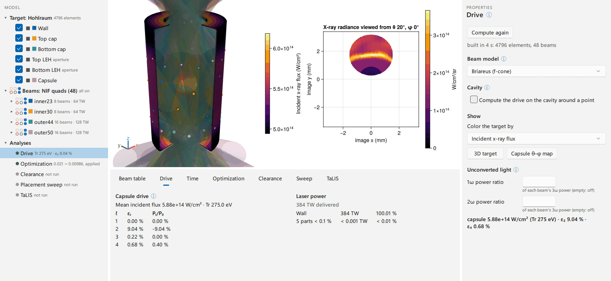
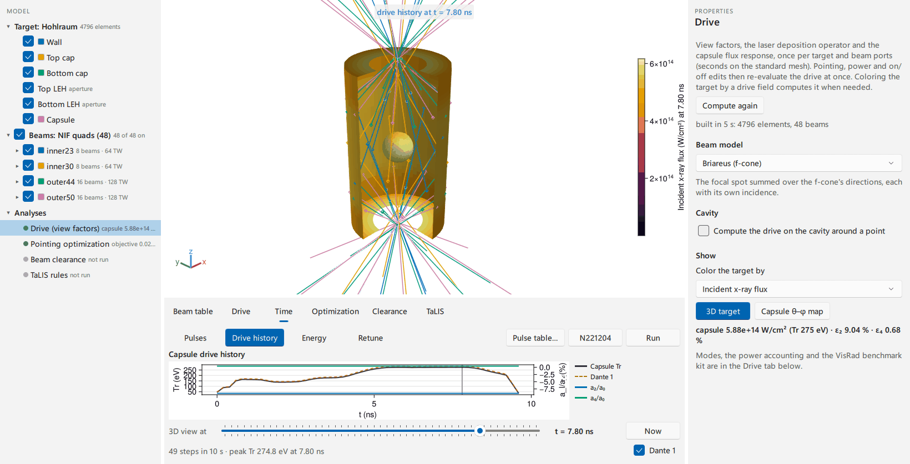
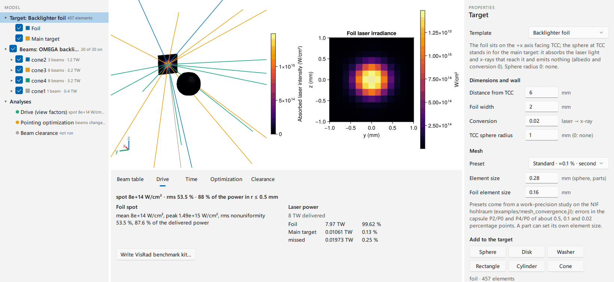

# Desktop application

The Briareus window (the BriareusGUI package and its `briareus` command) puts the
library's design loop on screen in the manner of a CAD tool such as VisRad: a target is
built or imported, the beams are pointed, and the laser deposition, the x-ray drive and
the capsule's drive symmetry follow every edit. The same window optimizes the pointing,
checks beam clearance from the target hardware and the NIF TaLIS target-configuration
rules, solves the drive through a pulse, and reads and writes VisRad pointing, beam
summary and workspace files. It serves target designers who would otherwise iterate in
VisRad, and anyone who wants the library's results without writing a script; every
action in the window is a call into the same functions the scripts and tutorials use.


The window is laid out as a CAD tool rather than as a sequence of steps: everything is
reachable at any time, and each analysis reports when its result is out of date.

## Install

### The `briareus` command

The command needs Julia 1.12.7 or later and no further Julia knowledge.

1. Install Julia through juliaup: on Windows `winget install --id 9NJNWW8PVKMN -e`
   (Julia from the Microsoft Store), on macOS or Linux
   `curl -fsSL https://install.julialang.org | sh`. Open a new terminal afterward.
2. Install the app and compile it (about ten minutes, once):

   ```
   julia -e "using Pkg; Pkg.Apps.add(\"BriareusLauncher\")"
   ```

   or, at the Julia prompt's package mode (`]`), `pkg> app add BriareusLauncher`.
3. Put Julia's app folder on the `PATH` (the install prints a warning when it is
   missing). Windows, in PowerShell:

   ```powershell
   $p = [Environment]::GetEnvironmentVariable("Path", "User")
   [Environment]::SetEnvironmentVariable("Path", "$p;$HOME\.julia\bin", "User")
   ```

   macOS (zsh): `echo 'export PATH="$HOME/.julia/bin:$PATH"' >> ~/.zprofile`; Linux
   (bash): the same line appended to `~/.bashrc`. Open a new terminal afterward.
4. Add Briareus to the desktop and the applications menu: `briareus --shortcut`. On
   Windows this makes Start-menu and desktop shortcuts, on macOS
   `~/Applications/Briareus.app` (listed by Launchpad and Spotlight), on Linux a menu
   entry.

The shortcut, or `briareus` in a terminal, then opens the window on a fresh design, and
`briareus design.briareus.toml` opens a saved session. A splash shows within about two
seconds while the window loads (about 20 s; the first start after an update compiles
for a few minutes). The command runs Julia on all threads (`--threads=auto`) and returns
when the window closes. A shortcut has no terminal: its output goes to
`%LOCALAPPDATA%\Briareus\briareus.log` (macOS: `~/Library/Logs/Briareus/`), and a
failure to start shows in the splash with the log's location.

`pkg> app update BriareusLauncher` updates the app, and `pkg> app rm BriareusLauncher`
removes it (the shortcuts are deleted by hand). The launcher is a package of its own so
that the splash shows before BriareusGUI loads: `julia -m` loads an app's whole package,
and BriareusGUI's dependencies take about 15 s to load.

### From Julia

The window opens from any Julia session started with several threads
(`julia -t auto`), so that background jobs leave it responsive:

```julia
pkg> add BriareusGUI

julia> using BriareusGUI

julia> sess = briareus()                   # or briareus(resolution = :fine)
```

`briareus` blocks while the window is open (Qt runs its event loop on the calling
thread) and returns the session when it closes. The window needs a graphical session,
and it cannot share a process with a GLMakie window or an offscreen GLMakie render.

### From a development checkout

BriareusGUI lives in the `BriareusGUI/` directory of the Briareus repository and the
launcher beside it in `BriareusLauncher/`; their `[sources]` entries point each at the
checkout's copy of the package it depends on, which Pkg honors for the active project
only. A checkout runs the window as

```
git clone https://github.com/stillyslalom/Briareus.jl
julia --project=Briareus.jl/BriareusGUI -t auto -e "using Pkg; Pkg.instantiate(); using BriareusGUI; briareus()"
```

and installs the `briareus` command from the checkout with
`julia -e "using Pkg; Pkg.Apps.develop(path=\"Briareus.jl/BriareusLauncher\")"`,
followed by `julia --project=Briareus.jl/BriareusLauncher -e "using Pkg; Pkg.precompile()"`.

## A first session

The steps below design the drive of a NIF hohlraum from the built-in template; each
names the menu entries, and the panels are described in [The window](@ref).

1. **Open.** `briareus` opens on the hohlraum template with the 48 NIF quads at the
   published cone aims (`nif_quads`). The model tree lists the hohlraum's components
   (wall, caps, entrance holes, capsule), the beams by cone and quad, and the analyses.
2. **The target.** Selecting *Target* in the tree shows the template's dimensions,
   wall material and mesh in Properties. Target ▸ Mesh sets the element sizes:
   presets from a work-precision study on the NIF hohlraum
   (`examples/mesh_convergence.jl`) give the capsule P2/P0 and P4/P0 to about 0.5
   (coarse), 0.1 (standard) and 0.02 (fine, converged) percentage points.
3. **The beams.** Selecting a cone (a group) in the tree shows its aim, defocus and
   power, which apply to all its quads; a quad or a beam is edited the same way, and the
   *Beam table* tab lists every one of them. View ▸ Beams ▸ Volumes draws each beam's
   5 % contour along its f-cone, cut where it meets the target, so a beam clipping an
   entrance-hole lip or the capsule shows at a glance.
4. **Compute the drive.** Compute ▸ Drive (Ctrl + R), or coloring the target by a drive
   field (View ▸ Color target by ▸ Incident x-ray flux), computes the view factors on a
   worker thread (seconds on the standard mesh). From then on a beam edit re-evaluates
   the drive at once: the view factors depend only on the target and the beam ports.
5. **Read P2/P0.** The *Drive* tab lists the capsule's mode amplitudes ε₁…ε₄ and the
   Legendre ratios ``P_l/P_0``, and the laser power accounting (absorbed in the wall, on the
   caps' outer faces, on the capsule, and missing the target); for a foil it lists the
   spot statistics instead. *Capsule θ–φ map* in the drive's properties (or View ▸ Capsule
   θ–φ map) puts the capsule's flux map in the 3D view's place.
6. **Optimize.** Compute ▸ Optimize pointing selects the optimization task: the free
   parameters (aim, defocus and power per cone, quad or beam, within ± bounds), the
   objective (axisymmetric ``P_l``, all-m 3D modes, optionally holding the drive level, or
   a foil spot's nonuniformity) and the keep-outs. *Optimize* starts
   [`optimize_pointing`](@ref) in the background with progress and Cancel; the tab
   then compares the modes, the clipped power and the capsule clearance before and
   after, lists every parameter against its bounds (a parameter at a bound is marked),
   and *Apply result* writes the optimized pointing to the beam table. The model tree
   marks the result out of date once the beam table changes.

   

7. **Check clearance.** Compute ▸ Check clearance (the worst-case beam-to-hardware
   clearance over pointing, positioning and focus errors) and Compute ▸ TaLIS rules
   (NIF) run in the background and color the beams by their worst status. A result
   is marked out of date in the tree when the beams or the target change afterward.

   

8. **Save.** File ▸ Save session (Ctrl + S) writes the whole design, from the target to
   the analyses' settings and the view, to a plain TOML file; File ▸ Open session
   (Ctrl + O), or `briareus design.briareus.toml`, reads it back. Results are computed
   again on load. Edit ▸ Undo (Ctrl + Z) and Redo (Ctrl + Y) step through every design
   edit, typed, from a menu, from a file or from an applied optimization.

Two further steps use the drive's view factors without computing them again: an x-ray
image of the target (Compute ▸ X-ray image along the view) and the drive through a pulse
(the *Time* tab).





A backlighter design starts from File ▸ New target ▸ Backlighter foil, which loads the
OMEGA backlighter beams; the drive then reports the foil spot's mean and peak intensity,
its nonuniformity and the fraction of the power inside the spot, and the optimization
offers the foil-uniformity objective.



## The window

### Model tree

The left panel lists the target's components (a hohlraum's wall, caps, entrance holes
and capsule; diagnostic windows; free parts) with a swatch of their color in the 3D
view, so the tree is the color key; the beams by group, quad and beam with on/off boxes;
and the analyses (drive, optimization, clearance, TaLIS) with their state. Selecting a
node selects it in the 3D view and shows it in Properties; Ctrl + click adds components
or beams to the selection and Shift + click a range, which Properties then edits
together; a double click fits the view to it. The context menu holds the node's
actions, among them *Show* (draw it or not) and *Include in calculations*: a component
left out is drawn as a gray ghost and removed from the target (which becomes an open
enclosure), and beams left out are switched off.

### Properties

The right panel edits the selection. A value the geometry or a check rejects is
refused with the reason in the status line.

- **Target:** the template (hohlraum with capsule, backlighter foil, or custom parts
  only), its dimensions and wall material, and the mesh: a preset (above) or element
  sizes in mm for the wall and the capsule.
- **Windows** ([`WallWindow`](@ref)): azimuth, height, round (the default, with the
  exact disk area) or rectangular, open or closed with their own albedo and conversion
  efficiency. Overlapping windows, or a window past the end of the wall, are refused.
- **Parts:** spheres, disks, washers, rectangles, cylinders and cones placed anywhere,
  with their own albedo, conversion, sidedness, aperture flag and element size: a
  shield, a stalk, a detector aperture, a second foil. A part is placed in the
  chamber's frame, at an entrance hole (z pointing out of the hohlraum, so one placement
  mirrors between the two), at the backlighter foil, or in another part's frame, and
  moves with it when the target's dimensions or that part change; its position is given
  in Cartesian, cylindrical or spherical coordinates of that frame, and its orientation
  by the axis polar and azimuth angles and a rotation, in VisRad's order.
  A *mesh* part reads an STL file (Target ▸ Add part ▸ Mesh from STL file), scaled to
  mm, with its windings repaired ([`orient_mesh`](@ref)) and its surface remeshed into
  elements of the part's size ([`remesh_mesh`](@ref)); a multi-body ASCII STL of named
  solids gives one part per solid. A *VisRad object* part is a component of an imported
  VisRad workspace; a VisRad rectangle, sphere or cylindrical hohlraum keeps VisRad's
  own element grid unless the part is given an element size. A part's *Role* names it
  for the analyses: *Capsule* (the observed surface; a CAD capsule is replaced in the
  calculations by a sphere fitted to it, `fit_sphere`, so a fill tube does not
  count), *Backlighter foil* (the foil objective's spot), or *Thin film* (left out of the
  drive's cavity, below).
- **Beams** (a group, quad, beam, or any Ctrl-selected set): the aim relative to the
  ports (z, r and a tangential offset), a common aim point (x, y, z, as VisRad points a
  cluster at a reference point), or *Aim at* a component's centroid (the foil, an
  entrance hole, a part), which the beams then follow when it moves; defocus, power,
  on/off, and where the axis lands. *Look along beam* views the target from the beam's
  port. Beams belong to groups, as VisRad's clusters do: the cone by default, or any
  named set ("backlighter") made with *Move to group*; a group is edited, switched and
  optimized together, and its members keep their cone for the laser–plasma models. A
  NIF quad held as one beam splits into its four beams (their own ports, a quarter of
  the power each) to point them apart, and merges back.
- **Facility** (Beams ▸ Facility: NIF, OMEGA, OMEGA EP or other): the presets offered
  (NIF quads or beams at the published cone aims; the OMEGA hohlraum or backlighter
  sets; OMEGA EP's beams are imported, its port geometry is not built in) and the
  checks (the TaLIS rules are NIF's).
- **Analyses:** the settings and Run of the drive, the optimization, the clearance
  check and the TaLIS rules.

### 3D view

The center canvas navigates as a CAD tool: the wheel zooms toward the point under the
pointer, a left or middle drag orbits about the selection or the point under the
pointer, a right drag, Shift + drag or Ctrl + middle drag pans, a click selects a
component or beam, a double click fits it, `f` fits everything and the arrow keys
orbit by 15°. The near and far planes follow the eye, so nothing is clipped however
close the view. The View menu holds the standard views, a perspective or orthographic
projection, turntable (z up) or free rotation, the cutaway (its context menu sets its
width, its azimuth or the side facing the view, and the components it cuts), Look from
port (a beam's port or any θ, φ) and Save view as image. Help ▸ Mouse and keys lists
the bindings.

Beams are drawn as rays (each axis from the lens side to the surface it lands on, with
the aim point marked) or as volumes, and colored by group or by their worst clearance or
TaLIS status, in the tree's colors. The target is colored by component or by the
absorbed laser intensity, the x-ray radiosity or the incident x-ray flux (W/cm²),
which computes the drive when it is missing. Two further views share the canvas: the
capsule's θ–φ flux map (or the foil's face), and an x-ray image (Compute ▸ X-ray image
along the view, `xray_image!`), the radiance of the surfaces seen along the 3D
view's direction, framed as the view frames them and seen through transparent
apertures, so a hohlraum is imaged inside through its entrance holes. The image follows
the drive as beams are edited. View ▸ Map or image beside the 3D view shows either in a
second canvas next to the target.

### Results

The bottom panel's tabs:

- **Beam table:** every cone, quad or beam with its pointing, defocus, power and
  on/off, edited in place.
- **Drive:** the view factors are computed once per target and beam ports, on a
  worker; beam edits then re-evaluate at once. The tab shows the capsule's mode
  amplitudes and ``P_l/P_0``, the foil spot's statistics and the laser power accounting.
  File ▸ Write VisRad benchmark kit ([`write_visrad_kit`](@ref)) writes the SST
  pointing, the beam summary and beam table, a README with the geometry and the steps
  to reproduce the case in VisRad, and the Briareus results, reusing the drive's view
  factors.
- **Time:** the drive through a pulse. *Pulse table…* fires the beams with a pulse
  table ([`read_pulse_table`](@ref): power per beam against time, per cone group, quad
  or beam; disabled beams stay off), and *N221204 shape* with N221204's delivered pulse
  shape ([`n221204_pulse`](@ref)), each beam reaching its table power at the peak.
  *Run history* solves the drive at each time of the pulses on the drive's view factors
  ([`drive_history`](@ref)). Four charts, in the tree's colors: *Pulses* (each group's
  power and the total, TW), *Drive history* (capsule Tᵣ and a synthetic Dante 1,
  [`dante`](@ref), in eV; a₂/a₀ and a₄/a₀ in % on the right axis), *Energy* (the laser
  energy delivered by each time and where it went, kJ, [`energy_budget`](@ref)) and
  *Retune* (below). A click or drag on the chart, or the slider under it, moves the
  time cursor: the 3D view shows that step of the history on one color scale for the
  whole history; scrubbing computes nothing. *Now* returns to the drive at the table's
  powers, and a beam, pulse or target edit marks the history out of date.
- **Optimization:** the free parameters, objective and limits described in the first
  session; a capsule keep-out ([`SphereKeepOut`](@ref), on by default) keeps every
  beam's worst-case envelope off the capsule, and an entrance-hole keep-out
  ([`ApertureKeepOut`](@ref)) off the hole rims. The run stops at the iteration or the
  evaluation limit, whichever comes first; canceling keeps the best design so far.
- **Clearance:** the worst-case beam-to-hardware clearance ([`clearance`](@ref)) over
  pointing, positioning, hardware and focus errors on the chosen components, with
  progress per batch of beams and Cancel (keeping the beams already checked); rows
  colored pass, review or fail, the closest beam per component, and CSV export
  ([`write_clearance_csv`](@ref)).
- **TaLIS:** the NIF target-configuration checks ([`talis_check`](@ref)): 3ω capture,
  incidence and clearance, 1ω clearance and unconverted-light management, and the TAS
  stay-in zone, on the chosen capture components and checked components, with the rule
  tolerance and how it becomes a distance (measured from the target chamber center,
  from the beam's aim point, the larger of the two, or from a given point); the error
  stack and sampling are the clearance check's. The report shows a per-rule summary,
  every check colored by status with its margin, and the notes: the tolerance
  interpretation is marked ASSUMED and stays at the top, followed by the error set, the
  checks not evaluated and the requirements out of scope
  ([`TALIS_OUT_OF_SCOPE`](@ref)). CSV export with [`write_talis_csv`](@ref).

### Files in and out

- **Beams:** beam tables ([`read_beam_table`](@ref), [`write_beam_table`](@ref)); a NIF
  VisRad SST pointing CSV ([`read_visrad_sst`](@ref): aim points and defocus) and a
  Laser Beam Summary CSV ([`read_visrad_summary`](@ref): pointing, defocus, power and
  spot). Beams off or absent in a file are switched off at their power, and the readers'
  warnings are listed.
- **VisRad workspaces:** File ▸ Import VisRad workspace reads a workspace's components
  as VisRad object parts and its beams, on worker threads with progress; File ▸ Export
  VisRad workspace writes the beams back into a copy of the imported workspace
  ([`write_visrad_workspace`](@ref)).
- **Results:** File ▸ Export target as STL ([`write_stl`](@ref), mm); File ▸ Export
  results ([`write_results`](@ref): the drive's per-element laser, radiosity and flux,
  the power per component and beam, and the capsule modes as CSV, with the session that
  produced them).
- **Retune to a reference drive** (Compute ▸): from the pulse table of a reference
  shot that fired every beam of the table, the enabled beams' powers are retuned at
  each time of the table to restore the reference's capsule drive level and its modes
  through l = 4 ([`retune_drive`](@ref)), within a limit relative to the reference
  powers and optionally staying near them; the disabled beams are the ones the shot
  loses. The new pulses are written as a pulse table; the dialog reports the worst-time
  mode 1 and Tᵣ change before and after, from drive histories of both, and the Time
  tab plots each group's power on the reference and retuned pulses and ε₁ before and
  after.

### CAD workspaces and large targets

A CAD workspace can bring hundreds of thousands of facets, most of them mounting
hardware far from the target. On import, a CAD part that reaches farther than twice the
farthest aim point of the beams the workspace fires is drawn only (from its file's
facets, not remeshed) and left out of the calculations; the status line names these
parts, and *Include in calculations* puts one back. Beams the workspace leaves off are
not drawn when most are (View ▸ Beams ▸ Show beams that are off).

The drive of a target with CAD parts runs on its cavity around the target chamber
center (Drive ▸ Cavity; [`Briareus.enclosure`](@ref)): the elements bounding the free
space around the point, without the assembly's outer faces. A thin film modeled as a
solid that seals the point into a pocket (a capsule tent) is found and left out, and the
drive's properties list what the cavity kept of each part. The cavity's view factors are
balanced once aperture parts facing into the cavity close its entrance holes, with
under 1 % of its rays leaking (`CAVITY_MAX_LEAK`). A target whose x-ray view
factors would not fit in half the memory (`radiation_size`: about 160,000
elements on 32 GB) gets the laser deposition alone, with the reason in the status line.

Remeshing a CAD part and building a large target's ray-tracing hierarchy run on worker
threads: an edit takes effect at once, with the part drawn from its file's facets or the
previous target shown until the new one is ready, and a drive requested meanwhile starts
when the target is ready; so does a CAD capsule's sphere fit. A CAD part that is one
cylinder or sphere as a whole (a tube, a shell; [`fit_surfaces`](@ref)) is integrated on
that surface in the view factors; parts of several faces stay flat, and the drive's
status names flat parts carrying more than 50 facets per element (a curved face
tessellated in slivers, which slows the view factors).

## Scripting the window's steps

`briareus` returns its session (a `DesignSession`) when the window closes, and the
controllers in `BriareusGUI.Controllers` run the window's steps from a script without a
window. Text-field setters (`edit_*`) take the field's text and return `false`, with the
reason in the controller's `error`, when the geometry or a check rejects the value.

```julia
using BriareusGUI, BriareusGUI.Controllers
sess = DesignSession(resolution = :coarse)       # hohlraum + NIF quads
add_window!(sess.target; phi = 60.0, open = true) # a 1 × 1 mm hole in the wall
add_part!(sess.target, :disk; z = 7.5, r1 = 2.5, theta = 180)   # a shield above the top LEH
edit_mesh!(sess.target, :capsule_h, "0.05")      # element sizes in mm
edit_beam_node!(sess.beams, :group, "inner23", :z, "3.2")   # inner 23.5° cone aim z (mm)
import_visrad_sst!(sess.beams, "pointing.csv")   # or apply a VisRad pointing file
build_scenario!(sess)                            # view factors + evaluation
drive_summary(sess.drive.result[])
write_visrad_kit!(sess, "visrad_kit")            # benchmark kit for VisRad
start_optimize!(sess; spawn = false)             # blocks; spawn = true runs on a worker
accept_optimum!(sess)
start_clearance!(sess; spawn = false)
worst_rows(sess.review)
start_talis!(sess; spawn = false)                # TaLIS rules, same error stack
talis_rule_rows(sess.talis)
talis_notes(sess.talis)                          # the ASSUMED tolerance caveat first
export_results(sess, "results")                  # per-element and per-mode CSV
retune_to_reference!(sess, "reference.csv", "retuned.csv")  # disabled beams are the dropped ones
load_pulses!(sess, "reference.csv")              # or use_pulse_shape!(sess): N221204's shape
start_history!(sess)                             # drive_history on the drive's view factors
time_chart(sess, :drive)                         # what the Time tab plots (also :pulses, :energy, :retune)
set_time_cursor!(sess, 6.0)                      # the 3D view at the history step nearest 6 ns
save_session("design.briareus.toml", sess)       # the design as TOML; load_session! reads it
record!(sess); undo!(sess)                       # undo/redo steps (a window records them itself)
```

The screenshots on this page are produced by `dev/gui_screenshots.jl` in the
repository, which drives the real window through the same callbacks as its menus.
